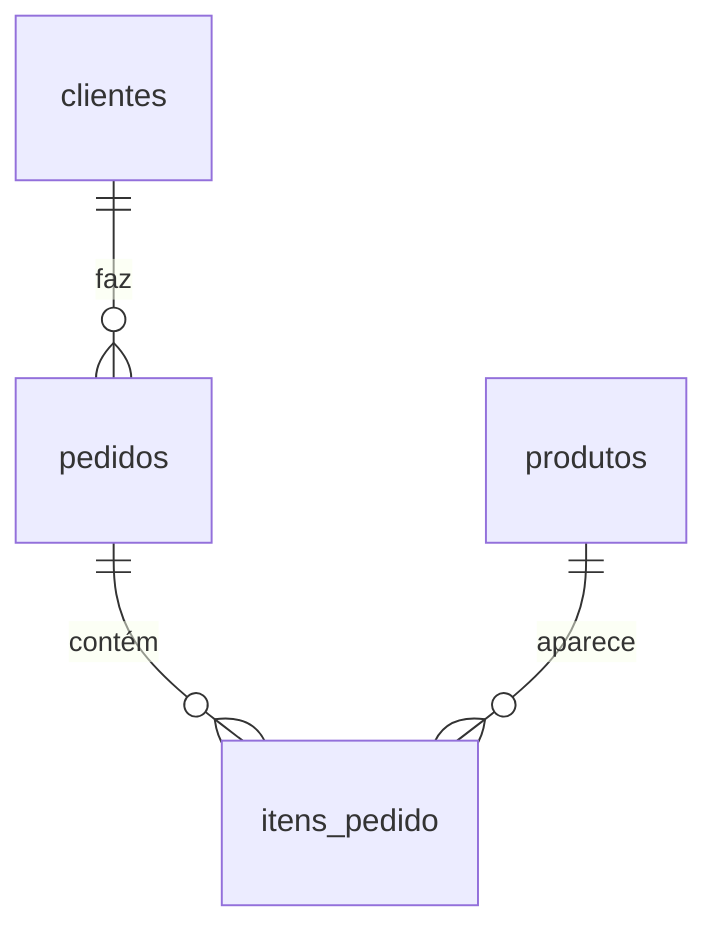

# Análise de Vendas — SQL

Projeto de portfólio com modelagem relacional completa em **SQLite** e queries analíticas cobrindo agregação, joins, subqueries, **CTEs**, **window functions**, **RFM** e **análise de coorte**.

## Modelo de dados



- `clientes` 1—N `pedidos`
- `pedidos` 1—N `itens_pedido`
- `produtos` 1—N `itens_pedido`
- Preço é snapshot em `itens_pedido.preco_unitario` (preserva histórico)

## Como rodar

Requer `sqlite3` instalado.

```bash
make                # cria vendas.db, aplica schema, views e seed
make query          # roda uma query informando o arquivo
make clean          # remove o banco
```

Manual:
```bash
sqlite3 vendas.db < schema.sql
sqlite3 vendas.db < views.sql
sqlite3 vendas.db < seed.sql
sqlite3 -column -header vendas.db < queries/01_receita_mensal.sql
```

## Queries incluídas

| # | Arquivo | Técnica demonstrada |
|---|---------|---------------------|
| 01 | receita_mensal | `GROUP BY` + `strftime` |
| 02 | top_clientes | View + `ORDER BY … LIMIT` |
| 03 | produtos_mais_vendidos | `JOIN` triplo + agregação |
| 04 | ticket_medio | `AVG`/`MIN`/`MAX` |
| 05 | clientes_inativos | `LEFT JOIN` + `HAVING` + CTE |
| 06 | vendas_por_categoria | Subquery + cálculo de % |
| 07 | crescimento_mom | **Window** `LAG()` |
| 08 | rfm | **CTE + NTILE()** — segmentação RFM |
| 09 | coorte_retencao | **CTE em cadeia** — retenção por coorte |
| 10 | produtos_nao_vendidos | `LEFT JOIN … IS NULL` (anti-join) |

## Estrutura
```
schema.sql     → tabelas + constraints + índices
views.sql      → vw_receita_pedido, vw_cliente_360
seed.sql       → 10 clientes, 8 produtos, 30 pedidos, 40+ itens
queries/       → 10 queries analíticas
docs/          → dicionário de dados
```

## Stack
SQLite 3 · SQL analítico · Modelagem relacional